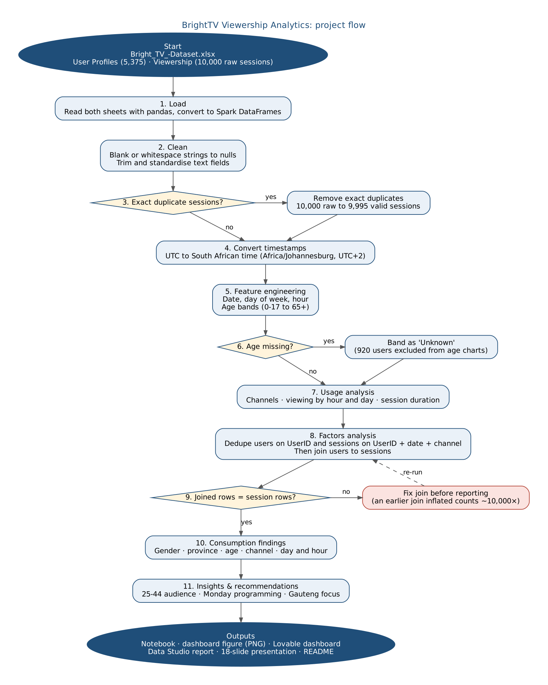
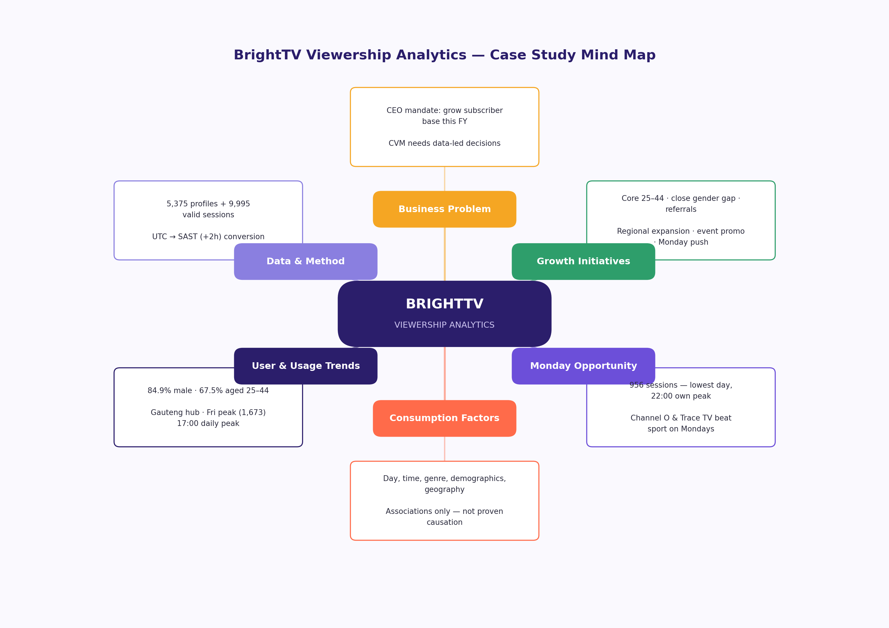
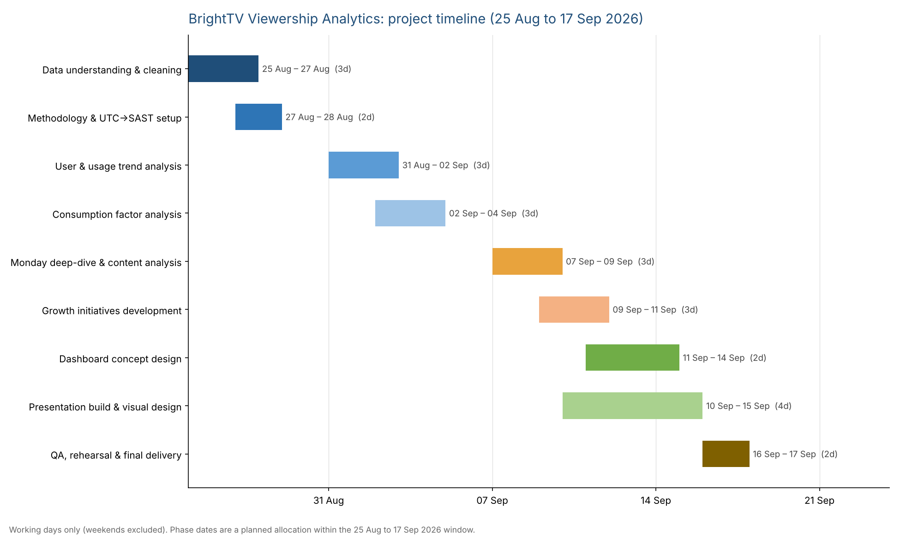

# 📺 BrightTV Viewership Analytics

A CVM (Customer Value Management) data analytics case study for BrightTV, analysing user
profiles and viewing session data to turn raw behaviour into subscriber growth actions.

<p>
  
  
  
  
  <a href="https://tvinsight-hub.lovable.app"></a>
  <a href="https://datastudio.google.com/s/sJkKNDXM2MQ"></a>
</p>

---

## 🔀 Project Flowchart



The flowchart shows each step from loading the raw data to the final outputs, including the decision points. The Graphviz source is in [`brighttv.dot`](brighttv.dot).

The same flowchart is also on Miro: [Bright TV project flowchart (Miro)](https://miro.com/app/board/uXjVEMTY4cg=/?share_link_id=118771072804).

---

## 🎯 The Brief

BrightTV's CEO set a clear objective: **grow the subscription base this financial year.**
This case study answers four questions for the CVM team:

1. What are the main user and usage trends of BrightTV?
2. What factors are associated with consumption?
3. What content should be recommended to lift low-consumption days?
4. What initiatives can further grow BrightTV's user base?

---

## 📺 Dashboards

- **[tvinsight-hub.lovable.app](https://tvinsight-hub.lovable.app)** — interactive
  dashboard covering subscriber demographics, top channels, and viewing patterns by hour
  and day.
- **[Data Studio report](https://datastudio.google.com/s/sJkKNDXM2MQ)** — Google Data
  Studio version of the same analysis, for stakeholders who prefer that format.

---

## 🗂️ Repository Contents

```
BrightTV_Analysis/
├── README.md
├── BrightTV_Viewership_Presentation.pptx
├── BrightTV_Analysis_Dashboard.ipynb
├── BrightTV_MindMap.png
├── BrightTV_GanttChart.png
├── BrightTV_Project_Description.pdf
├── BrightTV_Dashboard.pdf
├── BrightTV_Case_Study.pdf
└── Bright_TV_-Dataset.xlsx
```

---

## 📊 Presentation

**`BrightTV_Viewership_Presentation.pptx`** — 18 slides with full speaker notes,
built for a 20-minute CVM walkthrough.

---

## 🧠 Mind Map

**`BrightTV_MindMap.png`** — the whole case study on one page: business problem,
methodology, trends, consumption factors, the Monday opportunity, and growth initiatives.



---

## 🛠️ Tools Used

- **Python** (the main analysis language)
- **PySpark** on Databricks for loading, cleaning, joins, and aggregation
- **pandas** for reading the Excel file and preparing the charts
- **Matplotlib** for the dashboard figure and charts
- **Databricks** notebook and Unity Catalog
- **Lovable** for the interactive dashboard
- **Google Data Studio / Looker Studio** for the stakeholder report
- **PowerPoint** for the 18-slide presentation
- **GitHub** for version control and documentation

---

## 🔄 Process

1. **Load:** read the `User Profiles` and `Viewership` sheets into pandas, then convert them to Spark DataFrames.
2. **Clean:** turn blank strings into real nulls, remove exact duplicate sessions (10,000 to 9,995), and convert UTC timestamps to South African time (UTC+2).
3. **Engineer features:** add the date, day of week, hour, and age bands used in the charts.
4. **Analyse usage:** look at channels, viewing by hour and day, and session duration.
5. **Analyse factors:** join users to viewing sessions on `UserID`, after removing duplicates on both sides so the row count is validated.
6. **Build outputs:** create the combined dashboard figure, the Lovable dashboard, the Data Studio report, and the presentation.

---

## 📅 Project Timeline

**`BrightTV_GanttChart.png`** — how this case study was delivered, from 25 August
to 17 September 2026 (18 working days, about 3.5 weeks), from data cleaning through to final QA. Each
phase is shown with its start and end date.



---

## 📓 Notebook

**`BrightTV_Analysis_Dashboard.ipynb`** — the full analysis notebook behind the
dashboards and findings above.

---

## 📁 Source Data

| File | Description |
|---|---|
| `BrightTV_Case_Study.pdf` | Original case study brief and assignment instructions |
| `BrightTV_Project_Description.pdf` | Project description document |
| `BrightTV_Dashboard.pdf` | Looker Studio dashboard export (audience, days, channels, recommendations) |
| `Bright_TV_-Dataset.xlsx` | Raw dataset — `User Profiles` (5,375 records) and `Viewership` (10,000 raw sessions) sheets |

---

## 🔑 Key Findings

- 👥 **4,386** unique users generated **9,995** valid sessions (2.28 sessions/user) in Q1 2016
- ♂️ Audience is strongly male-skewed (**84.9%**) and core-aged **25–44** (67.5%)
- 📍 **Gauteng** is the largest observed province, though the audience is national
- 📈 **Friday** (1,673 sessions) is the peak day; **Monday** (956) is the weakest
- 🕔 **17:00 SA time** is the daily peak viewing hour; live sport content leads overall
- 🎵 On Mondays specifically, music/entertainment channels (Channel O, Trace TV) outperform sport

---

## 💡 Recommendations

- Deepen engagement with the **25–44 core audience** via tailored content bundles
- Launch a **female-focused acquisition** campaign to close the gender gap
- Build **referral/advocacy programmes** around highly-engaged younger (18–34) users
- Expand **regional marketing** beyond Gauteng
- Lead growth campaigns with **major sport/event content**
- Run **Monday-specific entertainment programming** and evening-timed engagement pushes

---

## 🔬 Data & Methodology

Two source tables — `User Profiles` (5,375 records) and `Viewership` (10,000 raw session
records, 9,995 after removing exact duplicates) — were joined on `UserID`. All session
timestamps were converted from **UTC to South African time (UTC+2)** before any
day-of-week or hour-of-day analysis. Full detail is in the presentation's *Data &
Methodology* slide.

---

## ⚠️ Caveat

Findings throughout this analysis describe **observed associations** in the data, not
proven causation. Confirming what actually drives consumption (e.g. content genre, time
of day) would require controlled testing such as scheduling or content A/B trials.

## 📊 Dashboard (Canva)

[View the BrightTV viewership dashboard (PDF)](BrightTV_Viewership_Dashboard.pdf)
